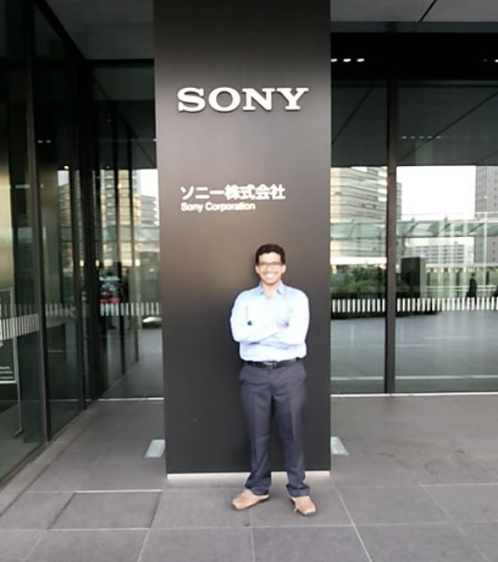
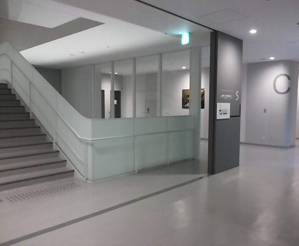
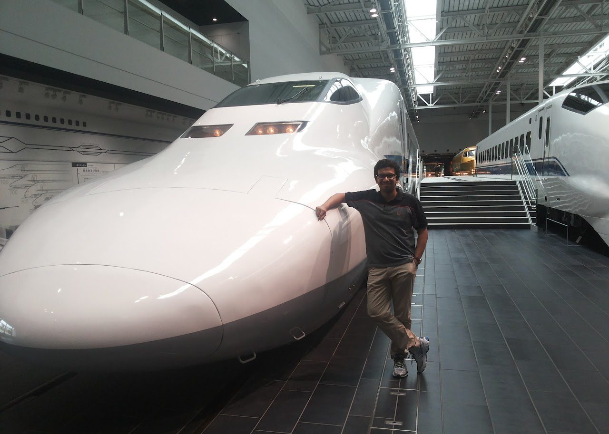
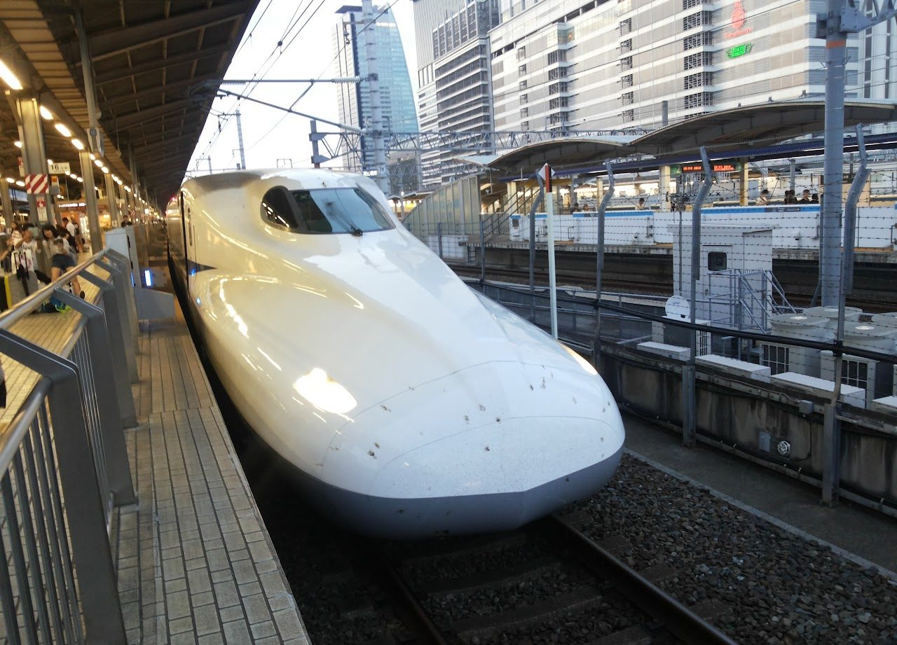
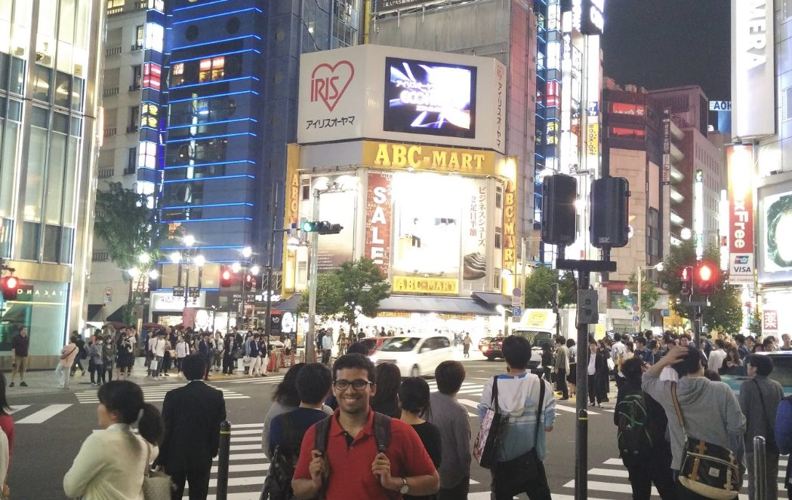
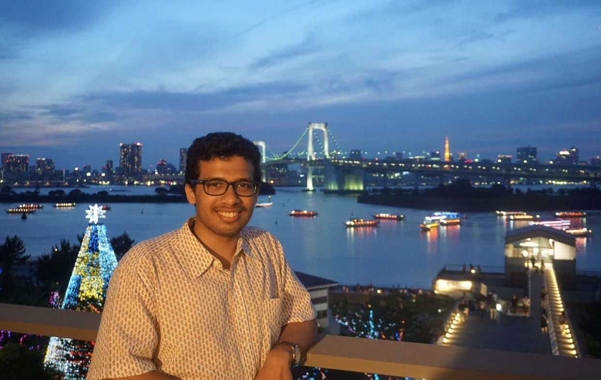

## The (cool) project at Sony

I work at the ‘Intelligent System and technology design’ department at Sony, and my work profile mainly revolves around developing the next generation vital sensor technology and using sensor fusion, which will be used in Sony’s smartwatches for mood sensing and related applications.

The workload at Sony is quite chilled out, and in contrast to the grueling and ever-demanding schedule at IITB, the internship feels quite like a breeze.

## Working at Sony

Despite having visited Japan before as a tourist, working in Japan — especially at the headquarters of an electronics giant such as Sony — has been a totally new and exciting experience for me.

Sony's HQ is an enormous and plush empire, with generous helpings of luxury and sophistication oozing from all corners, that deliver the quintessential corporate feel. The office is littered with Sony gadgets all around — huge Bravia TVs in meeting areas, Sony projectors in conference rooms, and Sony VAIO laptops in everyone's hands which makes it feel like being on a different Sony-planet inside the heart of Tokyo.

It is also thrilling to have this privilege of working with the engineering top brass at Sony. For instance, I’m blessed to be working with Okubo-san, who leads the effort behind all the face detection technology being employed in all Sony phones and other Sony gadgets today.

Yet, everyone is so approachable, friendly, and kind, it can almost get awkward to be treated with so much warmth. That I would end up playing badminton with an Okubo-san every week, was the last thing I had expected before coming here. It was overwhelming to receive a grand welcome in the office on the very first day. My table was specially decorated with a welcome board and I was surprised to even find my name put up on it! Right after this welcome, my mentor got several dozens of employees from almost half of that floor in the building to gather together, while I was left clueless about what was happening, because he spoke to everyone in Japanese. It is only after he explained to me in English, that it dawned upon me that everyone had gathered around me to listen to my (impromptu) speech! I don’t remember what I spoke and whether it made any sense at all or not, but everyone clapped very cheerfully at the end, so I assume it either went well or that nobody understood anything of what I said in English!

One admirable feature about working here, I feel, is the amazing team-work and involvement shown by the employees even in other employees’ projects. I was pleasantly surprised to find my entire department (including Okubo-san) attending my hour-long final presentation about the project that I had worked on during the internship.

On a lighter note, language isn’t exactly a major barrier, but it can be quite entertaining at times. Some of my conversations with my mentor happen in boolean language, with sentences like- “If thees method work good, then we go thees way, if no, then can you please investigate error? ”

## Japan- The future of technology!

Great roads, great infrastructure, overall cleanliness, and opulence are all commonplace in the global north. However, what I found most striking and unique about Japan is the attention-to-detail and the benchmarks for automation that they set in even the simplest of things. You can sense the whiff of automation, even on the usual toilet seat in Japan, which feels like the cockpit of an airplane because it comes equipped with its own dashboard of buttons that control an automatic washlet with speed and direction-adjustable jets, an inbuilt music system(!!) and a temperature adjustable seat heating system.

*Posing alongside the imposing Shinkansen engine at the “SCMAGLEV and Rail Park” in Nagoya, Japan*

*Shinkansen pulling into Tokyo station*

The Shinkansen (bullet train) is yet another exciting experience to look forward to, but I must warn you, it feels so flawless, it can almost leave you disappointed. Before taking the ride, I had imagined it to be like sitting in a thrilling roller coaster racing furiously at 300 kmph. But the ride really is incredibly smooth and flawless; the tranquility inside will almost put one to sleep with its unblemished stability and composure. Perhaps could they have dialed down the flawlessness and composure a bit for the passengers to feel the exhilaration and rush of high-speed travel?

Everything in Japan is systematic, involves extreme planning but works like clockwork. So much structure to everyday life, in the backdrop of my super unstructured and unsystematic undergrad life, makes me feel a little uncomfy :) I remember feeling really unlike my undergrad-self, when one of these days, around lunch time, my mentor casually offered to take me on a treat in the restaurant downstairs, and instead of simply heading over to the restaurant, first made sure to promptly send me a calendar invite fixing an appointment with me for “Lunch party” from 11:20 hours to 12:25 hours!

Talking of insane levels of automation in Japan, Sony’s cafeteria has a simple but futuristic payment system, which, on the first day almost left me feeling technologically ancient, as I was lost in the amazement of its magic, trying to figure out how it worked! So it works something like this: the cafeteria is a huge place with a grand buffet laid out, for people to pick food items and proceed to the dining area. But the payment takes place only after we are *done* eating, on placing the empty tray and identification card on a sensor — which automatically detects the food consumed, computes the bill and deducts the correct amount from the ID card. The simple technique that floats this boat is that every type of food item is put in a unique type of bowl/dish that comes with a unique type of RFID chip that stores the cost of the corresponding item, which is then read and processed by the RFID sensor at checkout.

*At ‘Shibuya Crossing’, world’s busiest pedestrian crossing*

*Overlooking the Tokyo skyline*

If all this sounds exciting enough, I must add that all this is the story of just the first half of my internship period, since I am writing this mid-June. With almost another month yet to go, I can barely guess what else is in waiting!
