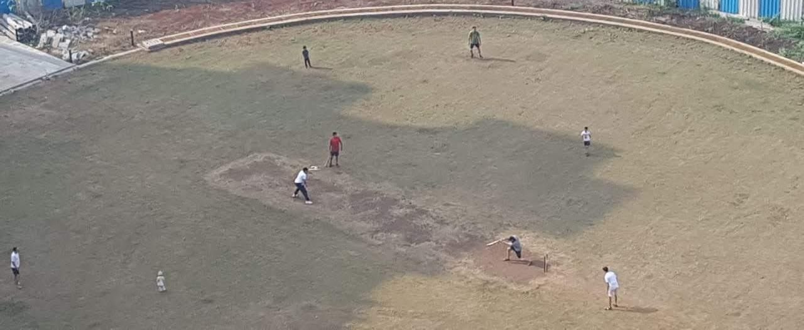
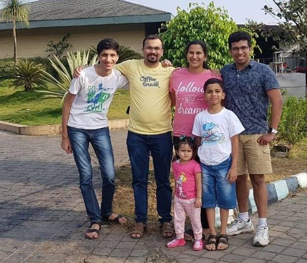

15.01.2020, Wednesday:

Stretching my legs mid-air on this unusually empty return flight taking me from Bangalore to Mumbai, I’m lost in thought, looking back at the breezy India trip that it has been so far. Originally, I was really hoping to finish this page before even the onward journey from Mumbai to Bangalore. I admit I’ve clearly been prioritizing procrastination so much that I'm actually writing it up only now while returning to Mumbai!

I’ve been back in India from US for only a couple of weeks so far, but I’ve managed to pack a whole lot in these last few days: attending the Mood Indigo festival at IIT Bombay with a close college friend, a night out at another close friend’s place, nervous few days trying to finish off a research paper, the quintessential Goa trip with parents, scampering back from the Goa trip for the "Tuberculosis vs AI" workshop in Mumbai and meetings with research partners, *this memorable Pune trip*, more work meetings in Bangalore and finally writing this page up in my diary!

I went to Pune last weekend, staying at ‘*Forest Trails*’ — away from the scrimmages of daily life — and genuinely felt like one weekend of my life was truly well spent. Unencumbered, and without a care in the world about all the goals I had to achieve in life, or the milestones to chase, papers to be published and connections to be built, I managed to thoroughly fulfill the cardinal goal of my life this weekend — which is “*to be happy!*”.

Those were the moments that I would paint in my version of “An Ode to a Grecian Urn” if I were John Keats.

I would freeze time at 12:30 pm of last Sunday and would love to keep baking under the hot afternoon sun, playing cricket with my favorite cousins. I'd love to keep batting and bowling to my heart’s content, reveling in the joy of smashing the ball all around the ground, and then gloating to my cousin, Mihir Dada’s amusing style of lecturing the poor bowler for getting hammered — because as a fielder, Mihir dada was repeatedly made to go fetch the ball from afar. I have a ton of images captured for good, on the ‘happy memories’ disk of my brain.

The previous night, we went out for customary dinner at *‘The Cliff*’ and came back home late at night. We turned all our rooms into bedrooms in order to accommodate all the hundred thousand relatives in the house that night. It was fun chatting up with Mihir dada till literally falling asleep and only to wake up to my adorable cousins, Athu and Dhamu, excitedly jostling me up and imploring me to go downstairs and play cricket. It was lovely diving into all the food overflowing on the dining table and come evening, once again bugging Manali taai at the eleventh hour before she had to leave, exhorting her to ditch her bus ticket and stay a little longer. It was fantastic talking to Ira, my sweet cupcake of a niece. I was so thrilled that she finally started recognizing me!

All the delight packed between the start and end of the trip occupied all of about 24 hours — from the time I was heading to Pune in Sandeep mama’s Honda till the time I was heading back home in my parents’ Honda. Having lived a fairly isolated life in a brand new city, Boston — finding new friends and making new connections during the most wintery, saturnine months of the year — so much pleasant human interaction (and extended sun exposure in winter!!) felt like no less than the floodgates of delight to me!
