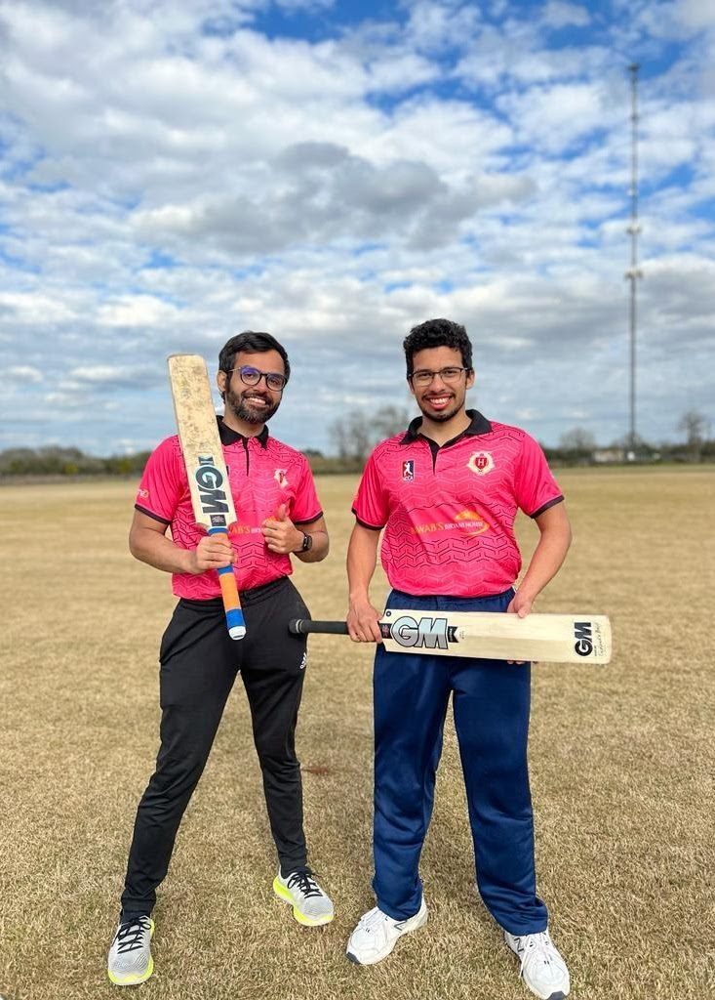

We participated in a US college cricket tournament at Houston this weekend and it was arguably the most hilarious and comical experience I’ve had playing cricket in any tournament so far. The tournament stretched over 4 days from Saturday till Tuesday; but our team was so sure that we wouldn’t make it past the initial group stages, that most of us booked return tickets for Monday itself. Let me make it clear why.

## The Team

As you may know, cricket is played 11-per-side, but we landed in Houston with an extended squad of only 10 players — our 11th player had to pull out last minute because of a health emergency. Among the surviving 10 players, Alex (name changed) was a baseball regular that our resourceful captain had roped in at the last minute trying to complete the team of eleven. Alex was a fine and fit athlete for sure, and I’m so grateful he stepped in, but unfortunately, he had never played or watched cricket before. Before the first game, on our way to the stadium from the Airbnb, Alex found himself in the back seat of the car, watching YouTube tutorials trying to quickly digest the rules of the game.

In the bowling department, our pace spearhead was a tall and burly quick bowler who would crank out bullet deliveries that frightened batsmen — but unfortunately, the more frightening aspect of his bowling was that he was also notorious for sending down chest-high beamers, once every few balls. We also had two reliable wicketkeepers in the team (myself included :P). The internal joke was that when our strike pace bowler comes on to bowl, we should have both wicketkeepers keeping wickets simultaneously to try and field his beamers.

## It Precipitated Quickly

In a turn of events during our second game, we managed to gift the opposition a hat-trick and suddenly found ourselves 8 wickets down. Things had precipitated faster than we were prepared for, and suddenly everyone in the dugout found themselves staring at Alex, the baseball player to go in next. To everyone’s horror, Alex was not even padded up and was nonchalantly just watching the game, not yet realizing that it was his turn to walk in next already. In a split second, four of us sprung up and started strapping cricket pads and helmets onto his person much like the pit crew of an F1 team that changes all four car tires within seconds during a pit stop.

When Alex made it to the crease, the focus was on giving as much of the strike as possible to the other batter. Unfortunately, the batsman at the other end was our otherwise designated number-11 batter, who perhaps for the first time had seen promotion to number-9. He is an excellent bowler, but embodies the quintessential tailender who would still bat at number-11 even if we were to put together a team of eleven number-11’s pooled across teams.

Meanwhile, the concern on the other end was that Alex hadn’t managed to go far enough in his YouTube tutorial and had no clue how running between the wickets works. I tried to give him a quick primer on the rules and tried to summarize what he needs to do to not get run out. Looking at our team’s plight, this generous guy from the opposite ranks even joined me in explaining the cricket rules to Alex.

## X-factor Unveiled

Batting with a distinctive baseball stance, Alex seemed primed to whack the ball hard and deposit it out of the park as soon as he managed to connect. Sweeping everyone off their feet, Alex bludgeoned two boundaries in the very first over he faced and our entire dugout erupted with delight.

Until this point, we had generally advised the batsman at the other end to always keep talking to Alex and to try and absorb as much of the strike as possible, to protect and guide Alex. With our quintessential tailender and Alex batting together however, gossip is that even the umpire couldn’t help but remark that Alex didn’t seem to need advice or help. Apparently he even suggested to our quintessential tailender to actually leave Alex alone, because he seemed to be scoring more runs than even our regular batters!

## The Third Game

In our third game, we were bowling first and we somehow ended up conceding a mountain of 200 odd runs in 20 overs. When we came out to bat, chasing the mammoth total, the opposite-rank wicketkeeper kept trying to rile us yelling “82!” “82!” from behind the stumps. Context is that we had managed to put up only a humble 82 on the board in our first game. We gave a sheepish, sly smile to ourselves under our batting helmets realizing that perhaps, little did he know about our even more humble total of 60 that we had folded for, in the game after.

Turning a deaf ear to all the anti-cheering, we decided to ignore the overwhelming target, bumped our fists and backed ourselves to play more freely and fearlessly. We raced off to a flying start and scored an aggressive 30+ runs off the first 3 overs with no loss of wickets. Prateek, my opening partner, hit some cracking shots, unleashing a flurry of free-flowing boundaries while I tried providing support with some towering sixes from the other end.

*Wicketkeepers and Opening partners*

For a fleeting moment perhaps, we may have made the opposition break out into a sweat. But no sooner did they perhaps begin to take us seriously, than both of us openers — I and Prateek — got out, in just the fourth over. Within the span of the next couple of overs, the rest of the team put up a procession and folded for a total score of just over 40!

Also hastening the procession of our batters, was the bored umpire who seemed eager to raise his finger at the drop of a hat — or at the slightest whiff of an LBW appeal.

## Packing Up Our Bags

As the Harvard Cricket Instagram page summed it up:

> *“We are surely down for now, but certainly not out for good.”*

For context, our team had seen a massive turnover during the pandemic and majority of the players were very new. Those that were not new, were nonetheless either very rusty, or dealing with their fitness situation having just survived the unprecedented pandemic cave. So although traditionally Harvard has always fielded a strong team, this time, our participation in this tournament was akin to Bermuda or Hongkong team's participation in the World Cup — clearly neither has even an iota of a chance at winning the tournament, but both still enjoy and try our best to heist an upset.
