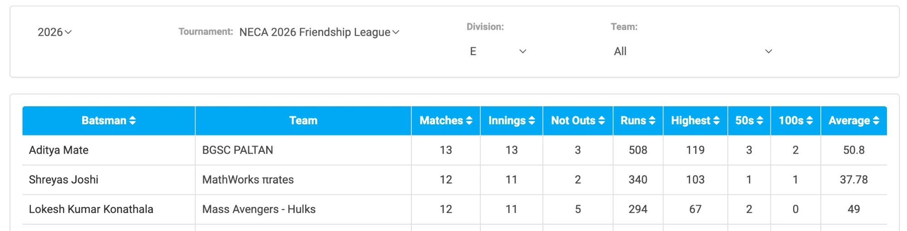
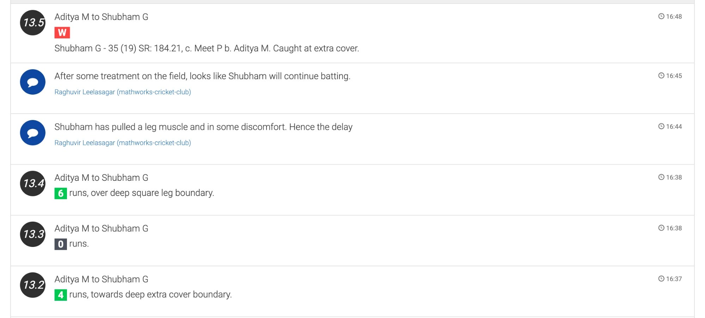

<strong>BGSC Paltan vs ISCC Stallions</strong>Sunday, Sep 12, 2026 · Westborough, MA

> *“We’ve had a dream run so far. But the final match is the all important match…”*, I wrote in our team group chat, on the eve of the match.

It was a much-anticipated championship final against the ISCC Stallions that our whole camp was excitedly and cautiously preparing for. I had the honor of being the captain of our team, BGSC Paltan. And indeed, this game proved entirely worthy of a nail-biting final! It was a heady mix of so much emotion, so much drama, so many close calls, and so many lessons learned. Lessons for cricket, and honestly also for life. But one thing is certain -- we went home with a ton of sweet memories permanently inscribed in our minds (and of course the cup 😉)! I will try to narrate some of my core memories of frustration, desperation, anxiety and jubilation as they appeared to me, standing in my shoes. 

In many ways this game reminded me of the India vs South Africa T20 World Cup final of 2024, in which Rohit Sharma led Team India's battle towards a hard-earned win. India had managed to grab victory from the jaws of defeat. In this case I think we snatched it straight from the oesophagus.

## Early dejection

After losing the toss and being asked to bat first, we had managed a modest but competitive total of 127 in the first innings. It was a slow and tricky outfield, but Kawal Sidhu's fearless and calculated half-century powered us to that total, with support from the other batters. 

Personally, I neither had a good game with the bat nor with the ball. I contributed 2 humble runs in 6 balls before getting myself run out. Later with the ball, I was smashed mercilessly for at least 2 towering sixes or boundaries in every over I bowled. I had enjoyed tremendous success with the bat in the whole season prior to this game. That had felt intoxicating – I was the highest run-scorer in the whole league with 500+ runs so far, had a batting average of 55+, and had already cranked out 2 centuries and 3 half-centuries in the season. For comparison, the second-highest run-scorer in our team had scored less than half the runs I had. The second-highest run-scorer across all 15 teams in our division was also at a distant 340. 

But in this game, I had found myself walking back to the pavilion after being dismissed for just 2 runs. That walk felt long and I remember feeling utterly helpless and dejected at having failed to contribute meaningfully in this “all important match”. I was thinking how inconsequential that mountain of 500 old runs was on the day. 

By the half-way stage, the game hung in the balance with both teams going neck and neck. All of the drama, emotional roller-coaster and back-and-forth teetering awaited us in the second half.

## The second innings

We started the second innings brilliantly, snapping up 4 quick wickets in no time. They struggled against our pace attack, spearheaded by Kawal paaji and Meet Patel. Both of them looked like out-of-syllabus bowlers in this contest and refused to take any prisoners in their fiery opening spells. The Stallions were down in the doldrums, reeling at 29/4 in 7 overs at one stage. However, the Stallions’ main batsmen were known to walk in only after the fall of their 3rd or 4th wickets. So we knew the real contest was only just beginning at this stage.

From here on --notwithstanding the initial setback -- their main star batsmen fought back hard and unleashed a massive counter-attack and started smashing sixes at will. This forced us on the back foot a little bit. In a blink, they had raced to 63/4 in 10 overs – suddenly now at par with the required run rate – bouncing back hard from a miserable situation just 3 overs ago. Their ability to tonk those huge sixes on-demand made it quite clear that the game wasn’t going down the wire. Whoever had to win, had to do it much sooner than the 20th over.

For a good part of the next several overs, they kept hammering sixes and boundaries at will -- in stark contrast to how it started -- making it seem like our other bowlers didn't know how to bowl. At one stage they needed just 43 runs in 8 overs with 5 wickets in hand. Their star batsman from their previous game was yet to even walk in, and was cooling his heels patiently in the dugout. Their other star batsman present at the crease at the time, was hitting sixes in all directions, effortlessly and relentlessly. Any spectator in the park at the time would have guessed the Stallions would race home in no time.

However, at these exact trying times, we were telling ourselves the exact opposite in our team huddle. We reminded ourselves how we discussed at the start of the game not to drop shoulders even if we get hit for a few sixes. The time to put that into action had arrived. Everything we discussed about showing temperament, nerves of steel, staying calm etc., had to be executed exactly right about then. And incredibly, like a true champion team, indeed, we delivered!!

## Getting rid of the albatross round my neck

At so many points, I felt the game slipping away. It reminded me of a past defeat in the tournament final of another cricket tournament we had played previously. That defeat was heartbreaking. Thoughts about losing yet again in a tournament final started cropping up. I caught myself imagining what would happen if we lost the game. How I would face people, and what I would explain. How I’d face my own teammates. What I would say to our club president. He had called me the previous evening and wished us luck saying “You guys have come this far. You don’t want to trip on this last hurdle”. I realize I might have been nearly as worried about facing other people’s reactions to our defeat as I was worried about facing defeat itself. In real life too, perhaps we burden ourselves so often with this unnecessary albatross of what other people might think of our situation. I’d be lying if I said I was confident we were still ahead in the battle. Fact is that I think we simply were not. It was hard and depressing, but I tried my best to compartmentalize those thoughts and tried instead to focus on what I could do at that time to simply maximize our chances of winning.

## Battling the last 8 overs 

It is one thing to play good cricket, score runs, take wickets and win games. Clearly it seemed to take a lot more to win a championship. This final tested our mettle. It asked us to show some character going beyond cricket – keeping cool, staying focused and showing the courage to fight even when it looked all hopeless with our backs pinned against the wall. 

Somehow, one by one, we found ways to keep taking wickets and kept ourselves in the hunt. It was all about not ruling ourselves out. We kept that one foot in the door, one toe sometimes, and that much proved enough. Every time their batsman hit a couple of sixes, our bowlers found a way to come back each time with a wicket.

In the 2024 world cup final, team India seemed headed to a certain defeat at one stage. Rishabh Pant faked a knee injury to buy time and stalled South Africa’s momentum. The tide completely turned from there and when play resumed South Africa seemed to have lost the plot and the rest is history. In an eerily similar turn of events, in the 14th over, their star batsman who was smacking it in all directions faced a (real) injury and was down on the ground. He had already dispatched the first four balls of the over for 10 runs. I was the unfortunate soul bowling that over, and I found myself praying that he retires himself out. Unfortunately, he didn't. Play halted for 10 minutes. However, when we resumed, the momentum was completely broken and the star batter got out the very first ball after the break!

## 6 more to go...

With 6 overs to go, we still had a tightrope to walk ahead of us – only a partly 33 runs left to defend with only 1 Kawal over and 1 Meet over left in our tank. It was crucial to get the bowling changes absolutely spot on at this stage. We were desperate, and I decided to spend the only remaining Meet over. It didn’t bring wickets, but he did a terrific job and gave away only 1 run. From this, I sensed their batters’ prudence and decided to take a gamble by delaying the last remaining Kawal over. We were still running low on runs left to defend, but we needed to do something different to lure them out of their defensive shell and manufacture a chance. So I brought in Sourav – a clever bowler, not so quick, but bowls with accuracy and is hard to hit. Sourav tempted them with a carrot and they took the bite. He conceded a couple of sixes and some extras in the process, but managed to get their other star batsman out. Sriram snatched some blinding catches this game and one of those helped Sourav on this occasion. We had sustained significant damage from the sixes that had rained so far, but had managed to send all their star batsmen back to the dugout at this stage. The tail was now exposed, but still we were left with only a scanty 17 to defend off the last entire 4 overs with 2 wickets still in their hand. This is still a walk in the park on any given day - an asking rate of just over 4 per over. I decided to spend the last of our remaining bowling trump cards at this stage and brought in Kawal bhai, hoping to go for the kill. I knew we were exhausting our key bowling ammunition with this move, but I decided that was our best bet. 

## The direct hit

As Kawal bhai marked his run-up to deliver his final over, I knew this was the decisive do-or-die juncture in the game and prayed he'd produce a moment of magic from somewhere. First ball of this over, the batsman punched it straight towards me, fielding at short midwicket. This deserved to be a dot ball, but to my horror, I saw the batters set off to steal a quick single, in a direct challenge to my fielding ability. With adrenaline already rushing through all my veins, I attacked the ball as quickly as I could and picked it up, negotiating a slight fumble. In a split-second, I tried to focus hard on hurling it at the single-stump target visible to me from midwicket. In that split-second, I told myself the chance to avoid another final-match defeat like the previous tournament was now. Sitting squarely in my hands. I launched the ball and mid-trajectory knew that my part was over; all I could do was try and give it a shot. Whether it would hit or not was for Him to decide. To my sheer delight and most incredibly, I could see the trajectory of the ball crossing paths with the stumps. And one more split second later, I saw the ball crash into the stumps. I don’t remember the last time I have effected a direct-hit run out in a cricket match. But in this one, God had decided to let me have it with the most extraordinary and unlikely run out! Half the remaining job done – we snatched a bonus wicket out of thin air and now needed just one more.

*The direct hit, from the live stream*

Kawal bhai with his sheer brilliance wasted no further time in bundling up the other remaining wicket, and rattled all three stumps. Clean bowled! Game over and BGSC Paltan won the championship!!

*BGSC Paltan, NECA 2026 champions*

## Fortune favors the brave

In the end, we got fortunate. We easily could’ve not won this game. Most direct hits don’t kiss the stumps. That day, mine did. God decided to let us win. I am super grateful for that. But I will also remember that fortune favors the brave. It wouldn't have helped if I had been brooding over my 2-run dismissal while fielding at midwicket when the opportunity came walking to me. Luck is when opportunity meets preparation. If we didn’t have the courage to try, there was no question of getting fortunate. Even when all seems lost and the hour seems darkest, I should always remember that it is not over until it is actually over and quitting is not allowed.

*The winning moment that I will cherish forever!!*

[Watch the winning moment on the live stream](https://www.youtube.com/live/nzbEs34ibJI?si=TXmsHbvo3i2cNp8W&t=12218)
