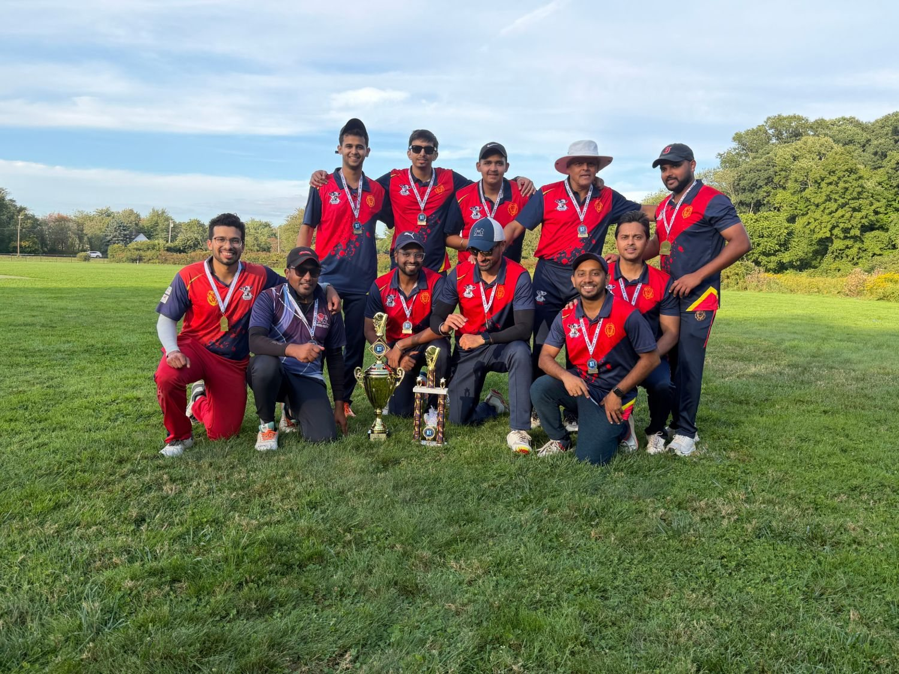

BGSC Paltan vs ISCC Stallions · Sunday, Sep 12, 2026 · Westborough, MA

> “We’ve had a dream run so far. But the final match is the all important match”

I wrote in our team group chat, on the eve of the match. I was captain of BGSC Paltan and we were preparing to face ISCC Stallions in the much anticipated final. And indeed this game unleashed everything – it was a heady mix of so much emotion, so much drama, so many close calls, and so many lessons learned. Lessons for cricket, and honestly even more so for life. But certainly, so many sweet memories locked in for lifetime! I will try to capture some of them as vividly as I can, here.

In many ways this game reminded me of the India vs South Africa T20 World Cup final of 2024, in which Rohit Sharma led Team India to a win. India had managed to grab victory from the jaws of defeat. In this case I think we snatched it straight from the oesophagus.

After losing the toss and being asked to bat first, we had posted a modest but competitive total of 127 in the first innings. It was a slow and tricky outfield, but Kawal paaji’s fearless and calculated half-century powered us to that total, with support from the other batters. At the half-way stage, the game hung in the balance with both teams pretty much in the contest. All of the drama, back-and-forth teetering and emotional roller-coaster was waiting for us in the second half.

## The second innings

We started the second innings brilliantly, snapping up 4 quick wickets in no time. The Stallions were down in the doldrums, reeling at 29/4 in 7 overs at one stage. They struggled against our pace attack spearheads – Kawal Sidhu and Meet Patel who looked like they came out-of-syllabus and took no prisoners in their fiery opening spells. However, the Stallions’ main batsmen were known to walk in only after the fall of the 3rd or 4th wickets. So we knew the real contest was only just beginning at this stage.

From here on, their main star batsmen fought back hard and unleashed a massive counter-attack smashing sixes at will that pushed us on the back foot. In a blink, they had raced to 63/4 in 10 overs – suddenly now at par with the required run rate, bouncing back from a miserable situation just 3 overs ago. Their ability to hit those huge sixes on-demand, made it clear that the game wasn’t going down the wire. Whoever had to win, had to do it much sooner than the 20th over.

For a good part of the next several overs, they kept hammering sixes and boundaries at will, making it seem like a walk in the park. At one stage they needed just 43 runs from 48 balls with 5 wickets in hand. Their star batsman from their previous game was yet to even walk in, and was cooling his heels in the dugout. Their other star batsman present at the crease at the time, was hitting sixes in all directions without breaking a sweat. Any spectator in the park at the time would have guessed the Stallions would race home in no time.

However, at these exact trying times, we were telling ourselves the exact opposite in our team huddle. We reminded ourselves how we discussed before the game not to drop shoulders even if we get hit for a bunch of sixes. The time to put that into action was then. Everything we discussed about showing temperament, nerves of steel, staying calm etc., had to be executed exactly right then. And like a true champion team, indeed, we delivered!!

## The albatross

At so many points, I felt the game slipping away. It reminded me of our past defeat in the tournament final of another cricket tournament we had played previously. That defeat was heartbreaking. Thoughts about another loss in a tournament final started cropping up. I caught myself imagining what would happen if we lost the game. How I would face people, and what I would explain. How I’d face my own teammates. What I would say to our club president who had called the previous evening and wished us luck saying “You guys have come this far. You don’t want to trip on this last hurdle”. I realize it is funny how I was equally worried about facing other people’s reactions to our defeat as I was worried about facing defeat itself. In real life too, perhaps we burden ourselves so often with this unnecessary albatross of what other people might think of our situation. Back to the game, I’d be lying if I said I was confident we were still ahead in the battle. Fact is that perhaps we simply were not. It was hard and depressing, but I tried my best to compartmentalize those thoughts and tried instead to focus on what I could do at that time to simply maximize our chances of winning.

It is one thing to play good cricket, score runs, take wickets and win games. It seems to take a lot more to win championships. This final was a test of mettle. It tested so much more character beyond cricket – keeping cool, staying focused and showing the courage to fight even when our backs were totally against the wall. But indeed, we showed it!! And God smiled upon us.

## One foot in the door

Somehow, one by one, we found ways to keep taking wickets and kept ourselves in the hunt. It was all about not ruling ourselves out. We kept that one foot in the door, one toe sometimes, and that much proved enough. Every time their batsman hit a couple of sixes, our bowlers found a way to come back each time with a wicket.

In the 2024 world cup final, team India seemed headed to a defeat before Rishabh Pant faked a knee injury to buy time and stalled South Africa’s momentum. The tide completely turned from there when play resumed and rest is history. In an eerily similar turn of events, their star batsman faced with a (real) injury after smashing 10 runs in first four balls of the fourteenth over. Play halted for 10 minutes. When we resumed, the momentum was completely broken and the star batter got out the very first ball after break.

With 6 overs to go, we still had a tightrope to walk ahead of us – only a partly 33 runs left to defend with only 1 Kawal over and 1 Meet over left in the tank. It was crucial to get the bowling changes absolutely spot on at this stage. I decided to spend the only remaining Meet over – it didn’t bring wickets, but gave away only 1 run. From this, I sensed their batters’ prudence and decided to take a gamble by delaying the remaining Kawal over. We were still running low on runs left to defend, but we needed to do something different to lure them out of their defensive shell. So I brought in Sourav – a smart bowler, who’s not so quick, but bowls with accuracy that makes him hard to hit. He showed them the perfect invitational carrot. He conceded a couple of sixes and some extras in the process, but managed to get their other star batsman out, owing to a blinder of a catch by Sriram. We had sustained some more damage from the raining sixes, but had managed to send all their star batsmen back to the dugout at this stage. The tail was now exposed, but still we were left with only a scanty 17 to defend off the last 4 overs with 2 wickets still in their hand. This is still a walk in the park on any given day. I decided to spend the last of the remaining overs from our strike bowlers at this stage, and brought in Kawal bhai, hoping to go for the kill.

## The direct hit

First ball of this over, the batsman punched it straight towards me at midwicket. I calculated this needs to be a dot ball, especially as I backed myself to be a good-ish fielder on the team. To my horror however, the batters had set off for a quick single and were directly taking on my fielding. With adrenaline already rushing through all my veins, I swiftly attacked the ball and after negotiating a fumble, in a split-second, I tried to focus hard on hurling it at the single-stump target. In that split-second, I told myself the chance to avoid the previous tournament-style defeat was now. Sitting squarely in my hands. I launched the ball and mid-trajectory knew that my part was over; all I could do was try and give it a shot – whether it would hit or not was for Him to decide. To my sheer delight and like pure magic, I could see the trajectory of the ball crossing paths with the stumps. And one more split second later, I saw the ball crash into the stumps. I don’t remember the last time I have effected a direct-hit run out in a cricket match. But in this one, “He” had decided to be kind to me with the most extraordinary and unlikely run out! Half the remaining job done – we snatched a bonus wicket out of thin air and now needed just one more.

*The direct hit, from the live stream*

Kawal bhai’s sheer brilliance took care of the other remaining wicket, disturbing all three stumps. Clean bowled. Game over. BGSC Paltan won the championship!!

*BGSC Paltan, NECA 2026 champions*

## Fortune favors the brave

Personally, I neither had a good game with the bat nor with the ball. I contributed 2 humble runs in 6 balls before getting myself run out. With the ball, I was smashed mercilessly for at least 2 towering sixes or boundaries in every over I bowled. I contributed one scintillating run out, but that was all.

I had enjoyed tremendous success with the bat in the whole season prior to this game. It was intoxicating – I was the highest run-scorer in the whole league with 500+ runs so far, at an average of 55+, adorned with 2 centuries and 3 half-centuries. For context, the second-highest run-scorer in our team was at a distant 233 runs. The second-highest run-scorer across all fifteen teams in our division was also at a distant 340.

But in this game, I had found myself walking back to the pavilion after being dismissed for just 2 runs. That walk felt long and I remember feeling utterly helpless and dejected to have failed to contribute meaningfully in this “all important match”. I was thinking how inconsequential that mountain of 500 old runs was on the day.

In the end, we got fortunate. We easily could’ve not won this game. Most direct hits don’t kiss the stumps. That day, mine did. Fate decided to let us win. I am super grateful for that. But I will also remember that fortune favors the brave. Luck is when opportunity meets preparation. If we didn’t have the courage to try, there was no question of getting fortunate. Even when all seems lost and the hour seems darkest, I should always remember that it is not over until it is actually over and quitting is not allowed.

*The winning moment that I will cherish forever!!*

[Watch the winning moment on the live stream](https://www.youtube.com/live/nzbEs34ibJI?si=TXmsHbvo3i2cNp8W&t=12218)
